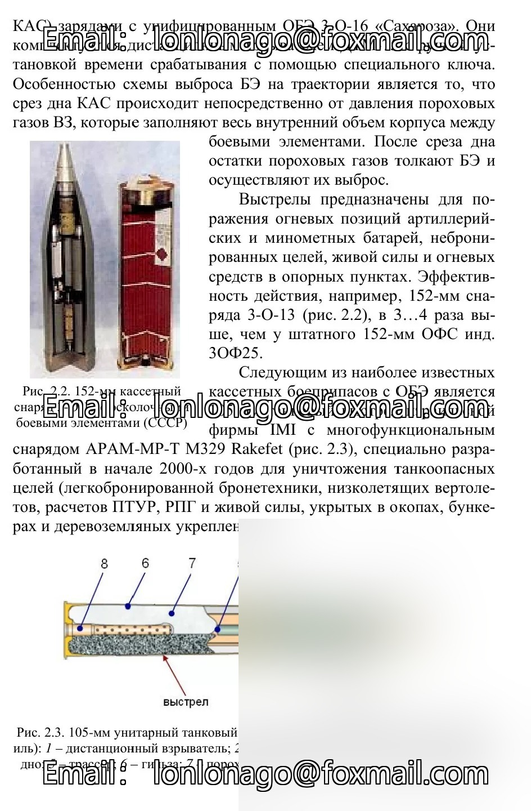
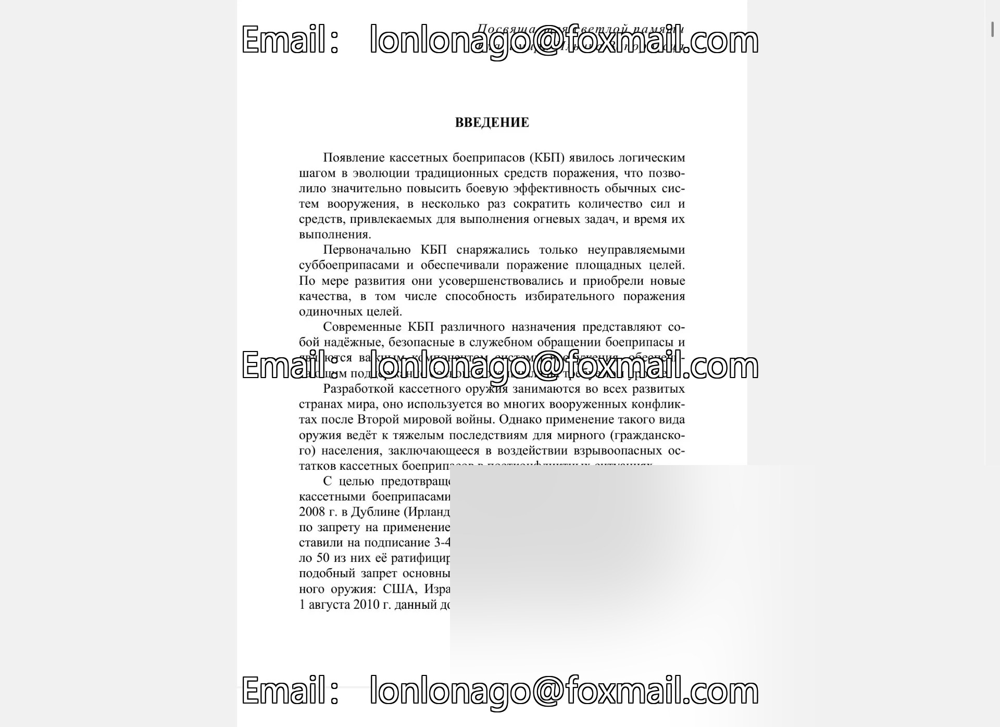
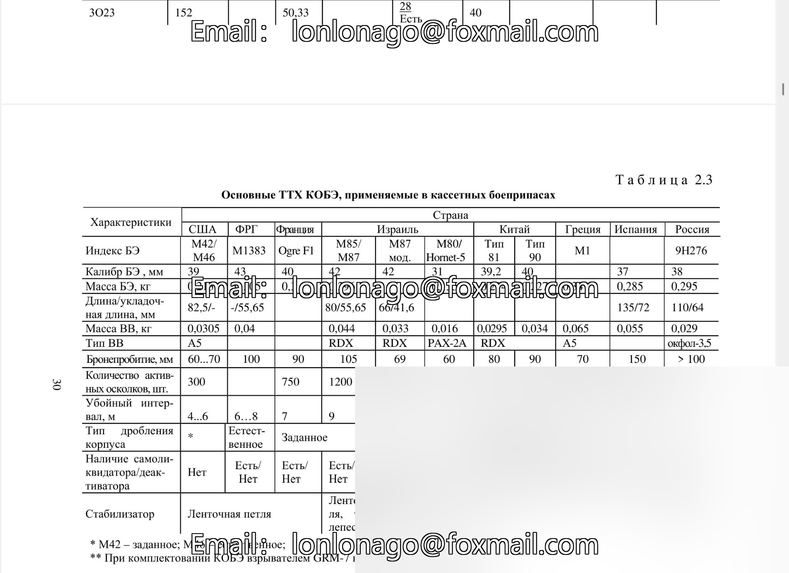
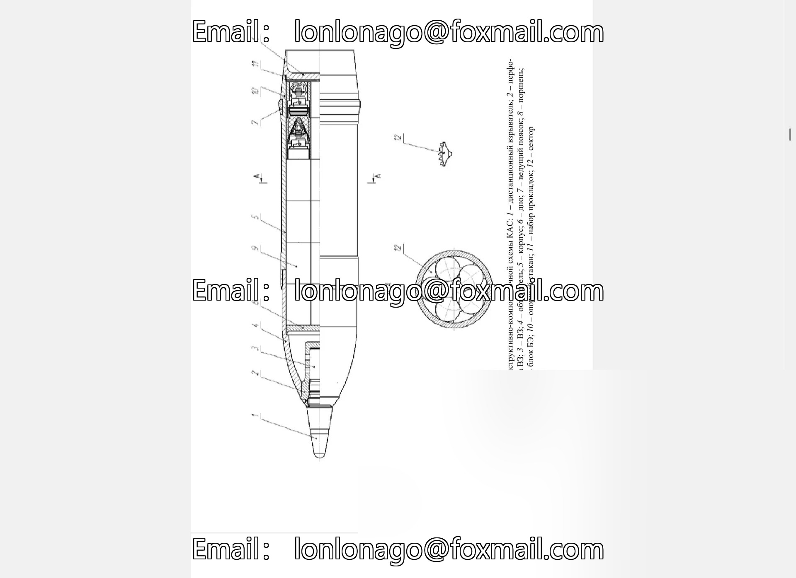
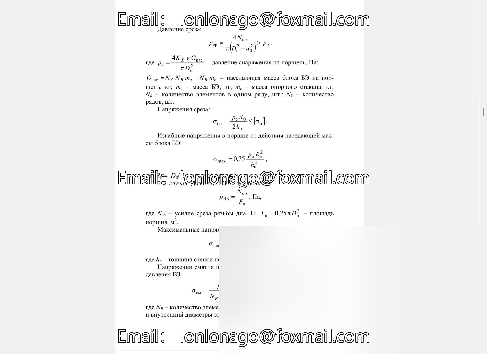

# "Basic Design of Ammunition for Cluster Firing Tanks"

## Body

"Basic Design of Ammunition for Cluster Firing Tanks"
Russian original technical document, the system analyzes the design principle, structural composition, performance parameters and application of clustered cannon troops ammunition.
The materials are for reference research on professional system design and technology, suitable for learning in military, aerospace, and defense-related majors as well as for materials collection.
upon sale. For direct requests, contact privately about issues.

This is the Russian original technical document for "Base of Design for Cluster Gun Troops Ammunition," analyzing its design principles, structural composition, performance parameters and application, serving as professional system design and technical research material for military, space and defense-related fields.

<!-- AI_ENRICHED -->

## Images

## Payment

Here is a pay link on Stripe ( https://buy.stripe.com/3cs8yP7sY87d0vu9AB ). Please contact me lonlonago@foxmail.com after funding $89, and I will send you a complete data files , thank you!

